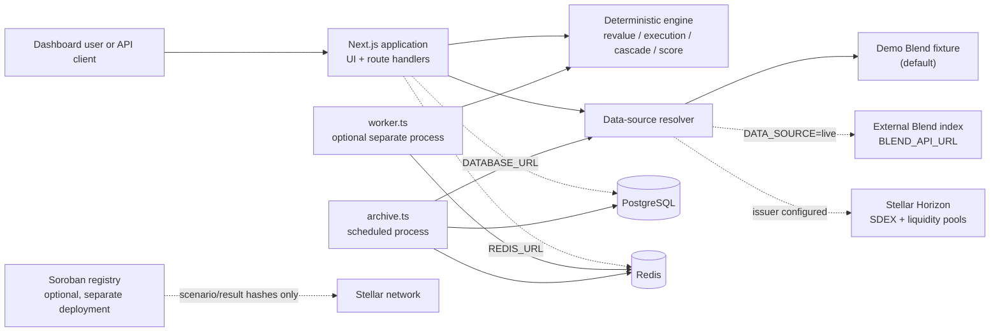
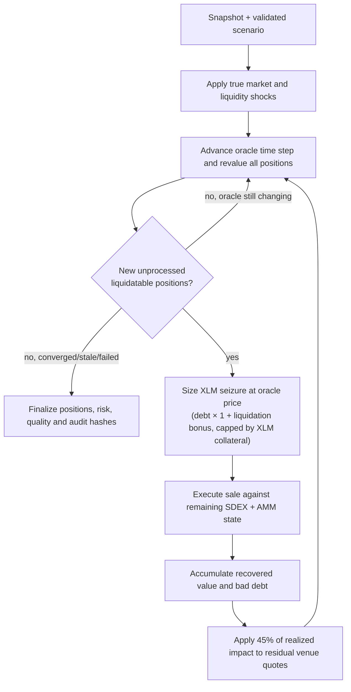
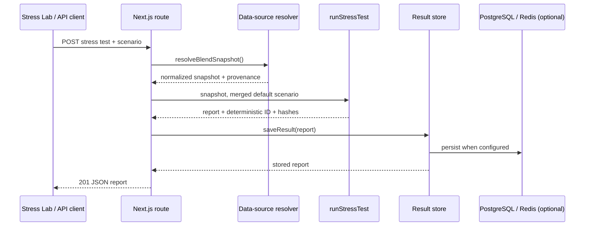

# SteBullX Architecture

> Implementation-oriented architecture review of the repository as inspected on
> 2026-08-12. This document describes the code that currently exists; it is more
> detailed than the short overview in `docs/ARCHITECTURE.md`.

## 1. System purpose and current scope

SteBullX is a non-custodial economic stress-testing application for Stellar DeFi.
Rather than only reporting a borrower's health factor, it estimates whether a
concurrent liquidation wave can be sold into the modeled XLM/USDC liquidity
available on the Stellar DEX (SDEX) and constant-product AMMs. The main output is
an auditable stress-test report: position classifications, liquidation demand,
multi-venue execution estimates, cascade rounds, potential bad debt, a risk score,
data-quality assessment, and hashes.

The deployed MVP is deliberately narrow:

- one protocol adapter: Blend;
- one required market: `XLM_USDC`;
- XLM collateral and USDC valuation assumptions are embedded in the current
  engine path;
- the default source is a deterministic, hand-authored `DEMO` fixture with 20
  positions, five SDEX bid levels, and two AMM pools;
- a normalized external Blend index and Stellar Horizon data can be enabled, but
  they are integration points rather than a bundled production indexer.

The application is a Next.js 15 / React 19 TypeScript monolith. The UI and HTTP
routes share one deployable, while the financial model is isolated under
`src/engine` and can be invoked by HTTP, a queue worker, replay code, or tests.
PostgreSQL and Redis are optional: the project remains runnable without either,
using intentionally ephemeral in-process state.

## 2. Architectural drivers

The design emphasizes the following properties.

| Driver | Current implementation |
| --- | --- |
| Reproducibility | Canonical JSON + SHA-256 hashes derive deterministic stress and replay identifiers from inputs and model version. |
| Provenance over implied accuracy | Every snapshot carries `DataProvenance` (`DEMO`, `INDEXED`, `LIVE`, etc.); demo reports deliberately receive low data-quality confidence. |
| Separation of protocol and market concerns | `ProtocolAdapter` produces normalized lending state; `MarketDataProvider` produces spot/depth/pools; engine code consumes only core contracts. |
| Transparent model behavior | Oracle timing, execution venue splits, AMM participation cap, cascade feedback rule, and risk-score weights are explicit in code and report assumptions. |
| Incremental deployment | No database or queue is required locally; PostgreSQL and Redis add persistence and distributed-worker capability. |
| Non-custodial operation | No key custody, signing, user transactions, or fund movement exists. The Soroban component only attests hashes. |

## 3. Runtime context



The solid paths are usable in a normal local/demo installation. Dashed paths are
optional and require environment configuration or separate operational processes.
The TypeScript application does **not** call the Soroban registry today; its
contract is an independently deployable attestation extension.

## 4. Repository and layer map

| Area | Responsibility | Important files |
| --- | --- | --- |
| Presentation | App Router pages, shared top navigation and simple visual components. Most dashboard pages render canned demo analytics; Stress Lab and Replay are interactive clients. | `src/app`, `src/components` |
| HTTP interface | Convenience routes and the versioned API. Route handlers translate HTTP to services/engine calls and map expected failures to JSON. | `src/app/api/**/route.ts` |
| Core contracts | Shared domain types, numeric helpers, stable canonical JSON serialization, SHA-256 hashing. | `src/core/types.ts`, `math.ts`, `hash.ts` |
| Simulation | Pure-ish financial model: revaluation, execution routing, cascade simulation, scoring, quality assessment, historical replay. | `src/engine` |
| Source adapters | Blend fixture adapter, validated external Blend-index adapter, Horizon SDEX/pool provider. | `src/protocols/blend`, `src/market-data` |
| Data | Explicit demo fixture, fixture replay episodes, dashboard canned runs. | `src/data`, `src/lib/demo-analytics.ts` |
| Services | Active source resolution, stores, queue/jobs, archive capture, API key check, structured logs/metrics. | `src/services` |
| Operations | Background worker and archiver process entry points; Docker/Postgres schema. | `scripts`, `Dockerfile`, `docker-compose.yml`, `services/api` |
| On-chain extension | Compact immutable scenario/result hash registry implemented in Soroban Rust. | `contracts/stress-registry` |
| Tests | Engine, queue, live payload/parser, Horizon pool, and archive behavior. | `tests` |

The intended dependency direction is:

```text
pages/routes/services/adapters  ->  engine  ->  core
data fixtures                   ->  core
engine                           ->  services/observability (instrumentation only)
Soroban contract                 ->  independent Rust package
```

`src/engine` does not import Next.js, database clients, Redis, HTTP adapters, or
the fixture. That is the key boundary that makes the economic model unit-testable
and usable from both synchronous and worker execution paths.

## 5. Domain model and extension points

`src/core/types.ts` is the architecture's source of truth. Its key aggregate is
`ProtocolSnapshot`:

```text
ProtocolSnapshot
  protocol + display name
  assets[]
  positions[]       -- collateral and debt amounts by asset id
  risk              -- collateral factor, liquidation threshold, bonus
  markets[]         -- spot reference and executable depth
  liquidity[]       -- order-book bids and optional AMM reserves
  provenance        -- kind, source, capture time, optional ledger and note
```

The principal ports are:

- `ProtocolAdapter`: gets assets, positions, risk parameters, markets, or a full
  normalized snapshot. `BlendAdapter` returns a clone of the demo fixture;
  `BlendApiAdapter` fetches and validates the normalized external payload.
- `MarketDataProvider`: gets spot, order book, liquidity, optional pools and
  historical prices. `StellarHorizonMarketDataProvider` currently supports only
  `XLM_USDC` and returns SDEX bids plus client-filtered, constant-product native
  XLM/USDC pools.
- `StressScenario`: named price and liquidity shocks, a detailed `OracleScenario`,
  cascade iteration limit and liquidation-capacity slippage limit.

This split supports new protocol adapters without changing financial calculations,
provided they normalize into the existing model. It does **not** yet make the model
asset- or market-agnostic: `runStressTest` explicitly searches for `XLM_USDC`, its
price map initializes `USDC = 1`, and liquidation demand sells XLM collateral.
Adding a protocol is therefore easier than adding a new collateral/debt/market
combination; the latter requires an engine generalization.

### Provenance model

`DataProvenance.kind` is one of `LIVE`, `INDEXED`, `CACHED`, `HISTORICAL`,
`DEMO`, or `SIMULATED`. The default fixture is permanently labelled `DEMO`;
it is never upgraded by a UI label. The external Blend adapter returns `INDEXED`
because it consumes a normalized index payload. Horizon liquidity is `LIVE`.
When live data is layered on a Blend snapshot, the snapshot-level provenance remains
the index provenance while the liquidity object has its own live provenance.

## 6. Data acquisition and normalization

### Default demo path

`resolveBlendSnapshot()` defaults to `new BlendAdapter().getSnapshot()`. The
adapter returns `structuredClone(demoBlendSnapshot)`, preventing a simulation from
mutating shared fixture state. The fixture gives the application a repeatable
baseline with no network, database, or chain dependency.

### Live path

Setting `DATA_SOURCE=live` switches the resolver to `BlendApiAdapter`. It requires
`BLEND_API_URL`; a missing endpoint, unsuccessful response, or malformed payload
throws instead of falling back to demo data. `parseBlendSnapshotPayload` validates:

- ISO capture time, assets and non-negative decimals;
- unique position identifiers and known asset references;
- non-negative finite collateral/debt/risk/market numbers; and
- the required risk maps and market fields.

If `STELLAR_USDC_ISSUER` is configured, the resolver additionally asks Horizon for
the SDEX XLM/USDC order book and up to five recent pages of constant-product
liquidity pools. It replaces the index snapshot's `liquidity` array with this live
liquidity snapshot. Horizon failure is logged as a warning and does not cause the
resolver itself to throw; the returned snapshot can therefore contain no liquidity,
in which case the stress engine rejects it because `XLM_USDC` liquidity is required.

There is no bundled Blend borrower indexer. A production deployment must run an
indexer that enumerates Blend users/events, resolves reserve exchange rates and emits
the documented payload shape at a known ledger. It should also coordinate the
indexer's snapshot ledger with the market-data snapshot as closely as possible.

## 7. Stress-test computation

### Revaluation

For each position, the engine computes:

```text
collateralValueUSD = Σ(collateral amount × scenario/oracle price)
debtValueUSD       = Σ(debt amount × scenario/oracle price)
weightedThreshold  = Σ(collateral value by asset × liquidation threshold)
healthFactor       = weightedThreshold / debtValueUSD
loanToValue        = debtValueUSD / collateralValueUSD
```

Health-factor classes are `HEALTHY` (at least 1.15), `AT_RISK` (1.00–1.15),
`LIQUIDATABLE` (0.75–1.00), and `SEVERELY_UNDERCOLLATERALIZED` (below 0.75).
Scenario validation bounds price shocks, liquidity shocks, oracle settings,
iteration count (1–50), and slippage before the run begins.

### Oracle model

`oracleReportedPrice` deliberately separates the true shocked market price from
the price used to determine liquidatability. A feed can have a delay, a linear
convergence ramp, signed divergence bias, a stale-after freeze, or total failure.
The simulation advances a deterministic time step of
`(delaySeconds + rampSeconds) / maxCascadeIterations` (minimum one second), so the
same inputs always produce the same oracle path. `oracleDelaySeconds` remains as a
backward-compatible alias.

### Liquidity and execution model

The liquidity shock reduces each SDEX level's base size and both sides of each AMM,
with a floor factor of 1%. Price shock also scales venue prices. A collateral sale is
routed repeatedly to the best available source:

1. choose the next SDEX bid or AMM with the highest marginal/touch price;
2. fill an order-book level directly, or sell through the AMM constant-product curve;
3. stop an AMM fill at the next venue's price floor, the requested amount, or the
   cap of 75% of that pool's initial quote reserve;
4. record one `ExecutionVenue` entry per venue and calculate average price,
   slippage/price impact, recovery and unexecuted collateral.

`liquidationCapacityUsd` is intentionally coarse: the largest $50,000 grid sale that
fully fills below the selected slippage threshold. It is a model metric, not an
executable quote.

### Cascade



Each position is processed once. Bad debt for a liquidation batch is the positive
difference between that batch's debt and actual recovered sale proceeds. After each
round, the engine applies 45% of realized price impact (capped internally) to residual
quotes and reanchors the next market price no higher than the realized average
execution price. The cycle stops when no further position becomes liquidatable after
the oracle has stopped changing, liquidity cannot execute any collateral, or the
cascade budget is exhausted.

The risk score is a visible weighted score: 20% liquidation exposure, 25% liquidity
coverage gap, 20% average price impact, 15% cascade depth, and 20% potential bad debt.
`assessDataQuality` reports a separate input/model suitability score; it is not a
probability that the result is true.

## 8. Execution flows

### Synchronous dashboard/API run



`/stress-lab` is the main interactive UI and posts to the unversioned
`/api/stress-test` endpoint on initial load and whenever the user clicks Run.
Several other dashboard pages are server-rendered displays of `cannedRuns`, which
execute the demo model during module initialization rather than reading the live API.

### Asynchronous run

`POST /api/v1/stress-tests/async` builds the same scenario and enqueues a `STRESS_TEST`
job. With Redis, job IDs enter the `stebullx:queue:jobs` list and an external
`npm run worker` process blocks on `BRPOP`, marks the job `RUNNING`, invokes
`processJob`, saves the result, and marks it `SUCCEEDED` or `FAILED`. Without Redis,
the queue is an in-memory array/map and the HTTP route schedules `processJob` with
`setImmediate`; this is convenient for one process but is not durable across restarts
or instances. Clients poll `GET /api/v1/jobs/:id` and receive the result once the
job has a result ID.

### Replay and archiving

`scripts/archive.ts` invokes `captureEpisode()`. It resolves the current snapshot,
finds the previous archive for the market, builds a ledger/price path, derives an
`observed` outcome by revaluing the previous snapshot at the new price, and writes
an archive episode. These observed values are explicitly model-derived estimates—not
indexed `FillLiquidation` events. The replay engine turns the recorded price decline
and assumptions into a scenario, runs the normal engine against the archived start
snapshot, and returns predicted-versus-observed error metrics.

Fixture episodes from `src/data/historical-archive.ts` are always available; persisted
episodes are merged in and override a fixture with the same ID. The Replay page uses
`GET /api/v1/replays` and `POST /api/v1/replays/:id/replay`.

## 9. Persistence, queues, and observability

### Result and archive storage

| Data | Write path | Read path | Durability notes |
| --- | --- | --- | --- |
| Stress/replay result | Always process-local `Map`; then PostgreSQL when `DATABASE_URL` is set; then Redis cache when configured | Local map first; otherwise PostgreSQL when present, then Redis fallback; without PostgreSQL, Redis fallback | Local state disappears on restart. Redis result TTL is 7 days. PostgreSQL table is `stress_tests`. |
| Job metadata | Redis key `stebullx:job:<id>` with a 24-hour TTL, or local map | Same backing store | Redis queue uses a list; local queue is process-only. |
| Replay archive | PostgreSQL `replay_archives`; otherwise Redis if configured; otherwise `data/archive-store.json` | PostgreSQL first; otherwise a non-empty local file, then Redis | Redis archive TTL is 90 days. The local-file-before-Redis read priority is worth considering if both are present. |

PostgreSQL is initialized through `services/api/schema.sql` with `stress_tests` and
`replay_archives` JSONB tables plus creation-time indexes. There is no migration
runner beyond the Docker init script, and large report objects are retrieved by ID
rather than queried by JSON attributes.

### Observability

`src/services/observability.ts` writes structured JSON lines to stdout/stderr and
tracks counters/durations. Simulations, replays and jobs record success/failure and
timing. In memory, metrics are per process; with Redis, counter and total-duration
keys are aggregated and `GET /api/v1/metrics` calculates averages. This is a small
instrumentation layer, not a full tracing/alerting system.

## 10. HTTP surface and authorization

All routes return JSON. The route implementation—not just the README—determines the
following access behavior when `STEBULLX_API_KEY` is configured:

| Route group | Operations | API key behavior in current code |
| --- | --- | --- |
| Unversioned convenience routes | `GET /api/protocols`, `/api/scenarios`, `/api/protocols/:id/markets`, `/api/stress-tests/:id`; `POST /api/stress-test` | Public |
| Versioned discovery | `GET /api/v1/protocols`, `/markets`, `/positions`, `/liquidity` | Public |
| Stress results/jobs | `POST /api/v1/stress-tests`, `POST /api/v1/stress-tests/async`, `GET /api/v1/stress-tests/:id`, `GET /api/v1/jobs/:id` | Protected by `x-api-key` when configured |
| Replay reads | `GET /api/v1/replays`, `GET /api/v1/replays/:id` | Protected when configured |
| Replay execution | `POST /api/v1/replays/:id/replay` | **Public in current code** |
| Metrics | `GET /api/v1/metrics` | Protected when configured |

The key check uses `timingSafeEqual` after rejecting length mismatches. Scenario
validation happens in the engine, and malformed/unsupported inputs generally receive
400. Resolver failures are normally returned as 503 by the stress-test/discovery
routes, although a live resolver that survives a Horizon failure can later produce a
400 from the engine because required liquidity is missing. Missing resources return
404. There is no rate limiting, RBAC, request-size policy, idempotency key, or audit
log of caller identity.

## 11. Deployment topology and configuration

The standard runtime is `next start` for local development, or the standalone output
generated by `next.config.ts` for containers. `Dockerfile` uses Node 24 Alpine: it
installs dependencies, builds the Next application, and copies the standalone server
and static assets into a production stage. `docker-compose.yml` starts only the web
application and PostgreSQL 16; it initializes the schema through a mounted SQL file.

| Variable | Effect |
| --- | --- |
| `DATA_SOURCE` | `demo` by default; only literal `live` selects the external index adapter. |
| `BLEND_API_URL` | Required for live protocol snapshots. |
| `STELLAR_HORIZON_URL` | Horizon base URL; defaults to testnet. |
| `STELLAR_USDC_ISSUER` | Enables verified-issuer SDEX/pool acquisition. |
| `DATABASE_URL` | Enables Postgres result and archive storage. |
| `REDIS_URL` | Enables Redis queue, job/result/cache state and aggregated metrics. |
| `STEBULLX_API_KEY` | Turns on the route-level key checks listed above. |
| `STEBULLX_ARCHIVE_FILE` | Overrides the local archive fallback location. |

Redis and the worker are not services in the supplied Compose file. In a multi-process
deployment, Redis must be provisioned separately and `npm run worker` must be kept
alive separately from the web service. Archive capture must likewise be scheduled by
the platform (cron, scheduler, or worker service); no scheduler is configured in the
repository.

On case-sensitive Linux deployment targets, verify the static asset casing: the source
tree contains `Public/` while the Dockerfile copies `/app/public`. Windows resolves
those paths interchangeably, but an image build should be exercised on the target
filesystem or the directory should be normalized to lowercase.

## 12. Reproducibility and the Soroban attestation boundary

`canonicalJson` sorts object keys recursively before hashing. A stress report has:

- `scenarioHash`: SHA-256 of the scenario;
- `inputHash`: SHA-256 of snapshot, scenario and `MODEL_VERSION`;
- `id`: `STRESS-` plus the first 16 uppercase hex characters of `inputHash`;
- `resultHash`: hash of the deterministic report content, excluding runtime
  generation time.

Replay IDs are derived from the archived episode and model version in the same way.
Exact reproduction therefore requires the full snapshot, scenario, model version and
assumptions—not the shortened identifier alone.

`contracts/stress-registry` is an optional Soroban contract that stores only a 32-byte
scenario ID, protocol symbol, scenario/result hashes, publisher, version, creation
time and expiry. `register` requires publisher authorization, rejects expired or
version-zero records, and refuses duplicate IDs. `get` and `verify` treat expired
records as unavailable. It stores no report artifact, simulates nothing, moves no
funds, and currently has no TypeScript client or route wired to it.

## 13. Test evidence

The repository contains 33 passing Vitest tests across two files (verified on
2026-08-12 with `npm.cmd test`). Coverage includes:

- revaluation thresholds, health classes and oracle delay/divergence/staleness/failure;
- order-book ordering, AMM routing, execution cap, price impact and venue breakdown;
- deterministic stress and replay output/hash behavior;
- in-memory job lifecycle and failure paths;
- Blend live-payload validation and unconfigured live adapter behavior;
- Horizon constant-product XLM/USDC pool filtering; and
- archive observer/capture behavior.

The tests are mainly unit and service-level tests. They do not currently exercise
Next route authorization consistency, real Postgres/Redis behavior, Docker image
construction, a live Horizon request, a deployed Soroban contract, or browser-level
UI behavior.

## 14. Production-readiness considerations

These are architecture observations, not changes made by this document.

1. **Generalize the financial model before claiming multi-market support.** The
   snapshot contracts are extensible, but the simulation hardcodes `XLM_USDC`, XLM
   sale sizing, and USDC as $1. A market/asset execution plan should replace those
   assumptions before adding protocol adapters to production.
2. **Produce atomic, ledger-pinned source snapshots.** The live Blend index and
   Horizon requests are independent and can have different capture times. A
   production index should record raw events/state, source ledgers, freshness and a
   coherent market snapshot before simulation.
3. **Use actual liquidation events for calibration.** `observeBetween` is useful for
   exercising replay mechanics, but its observed liquidation volume/bad debt is
   model-derived. An event indexer should replace it with recorded
   `FillLiquidation`/equivalent data.
4. **Harden distributed job semantics.** Redis `BRPOP` removes a job before it is
   completed; there is no visibility timeout, retry policy, dead-letter queue,
   concurrency control, or worker heartbeat. A worker crash can strand a `RUNNING`
   job. In-memory fallback is intentionally unsuitable for horizontal deployment.
5. **Make durable writes and access policy coherent.** Persistence spans a local map,
   Postgres and Redis without a transaction/outbox. Review the result-store schema
   for replay writes as well: the table requires non-null `data_kind` and
   `data_source`, while `HistoricalReplayResult` has no `data` field. Also apply the
   desired API-key policy consistently to replay execution and metrics.
6. **Add operational protection.** Enforce rate limits and request budgets, caller
   audit logs/RBAC as needed, fetch timeouts/retries, secret management, managed DB
   backups, dependency/Soroban audits, centralized logs/metrics, and alerts.
7. **Test the deployment artifacts.** Add CI that runs the test suite, production
   build, container build, database/Redis integration tests and end-to-end route/UI
   checks. Resolve the `Public`/`public` container-casing risk first.

## 15. Recommended evolution sequence

1. Stabilize the current deployment: integration tests, route authorization policy,
   container verification, durable storage behavior and queue recovery.
2. Build a ledger-pinned Blend indexer and capture raw/normalized snapshots with
   source metadata; use real liquidation events for replay calibration.
3. Generalize the engine to asset-aware pricing, debts, liquidation rules, close
   factors and multiple markets/venues.
4. Add additional protocol adapters only after the generic engine contract and
   provenance rules can represent their economics faithfully.
5. Introduce monitoring/alerts and, if useful, wire the already-separated Soroban
   registry into an explicit report-publication workflow.

This sequence preserves the repository's strongest current quality—transparent,
deterministic, clearly labelled modeling—while addressing the gaps that matter for
live operational risk infrastructure.
