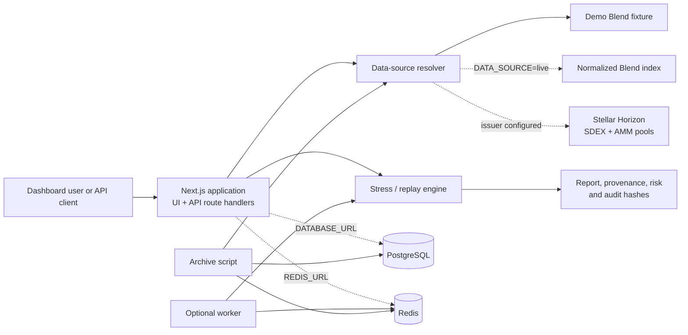

<p align="center">
  
</p>

# SteBullX

[](https://nextjs.org/)
[](https://react.dev/)
[](https://www.typescriptlang.org/)
[](LICENSE)

> Stress-test Stellar DeFi before it gets rekt.

SteBullX is open-source economic risk infrastructure for Stellar DeFi. It asks a question
that a position-level health factor cannot answer alone: **if many borrowers become
liquidatable together, can modeled market liquidity absorb their collateral sales?**

The current MVP runs deterministic Blend scenarios for `XLM_USDC`. It models an XLM price
shock, liquidity contraction, oracle delay or failure, liquidation execution across SDEX
bids and constant-product AMMs, feedback into residual liquidity, potential bad debt, and
a transparent risk score.

SteBullX is an analytical simulator. It is not a liquidation bot, trading venue, oracle,
custody service, investment product, or protocol-solvency guarantee.

## Contents

- [What is included](#what-is-included)
- [Data safety and provenance](#data-safety-and-provenance)
- [How the model works](#how-the-model-works)
- [Architecture](#architecture)
- [Quick start](#quick-start)
- [Configuration](#configuration)
- [Live and indexed data](#live-and-indexed-data)
- [Historical replay and archiving](#historical-replay-and-archiving)
- [API](#api)
- [Persistence, jobs, and observability](#persistence-jobs-and-observability)
- [Project structure](#project-structure)
- [Reproducibility and Soroban attestation](#reproducibility-and-soroban-attestation)
- [Testing](#testing)
- [Current scope and limitations](#current-scope-and-limitations)

## What is included

- **Deterministic stress engine** — Revalues positions under price shocks, simulates
  oracle behavior, routes modeled sales through multiple venues, and iterates a
  liquidation cascade.
- **SDEX + AMM execution model** — Fills in price priority across SDEX bid levels and
  constant-product XLM/USDC pools, with a per-pool participation cap and a per-venue
  execution breakdown.
- **Risk and data-quality reports** — Produces explicit component scores, provenance,
  assumptions, source metadata, and audit hashes with every report.
- **Interactive dashboard** — Overview, Stress Lab, Protocols, Markets, Liquidations,
  Scenarios, Historical Replay, Risk Reports, API, and Documentation pages.
- **Versioned HTTP API** — Synchronous and asynchronous stress-test endpoints, data
  discovery, replay, result lookup, and metrics.
- **Optional persistence and queueing** — PostgreSQL for reports/archives and Redis for
  jobs, result caching, and aggregated metrics. The project remains usable without
  either service.
- **Replay workflow** — Replays archived snapshots against a recorded market path and
  reports prediction-versus-observed error metrics.
- **Optional Soroban registry** — A separate contract that can attest scenario and
  result hashes on-chain without placing large report artifacts on-chain.

## Data safety and provenance

The default dashboard and API use a deterministic, hand-authored Blend/XLM-USDC fixture
in [`src/data/demo-blend-snapshot.ts`](src/data/demo-blend-snapshot.ts). It contains 20
modeled positions, five SDEX bid levels, and two modeled AMM pools. It is **not** a Blend
or Stellar mainnet snapshot and must not be used for liquidation, solvency, operational,
or investment decisions.

Every input and report carries a data class:

| Class | Meaning |
| --- | --- |
| `DEMO` | Hand-authored deterministic fixture; never a chain claim. |
| `INDEXED` | Normalized response from an external/project indexer with source metadata. |
| `LIVE` | Direct venue or chain-derived request, time-stamped and ledger-pinned where possible. |
| `CACHED` | Retained source snapshot with original metadata. |
| `HISTORICAL` | Historical source-identified state or replay fixture. |
| `SIMULATED` | Model output derived from one of the above inputs. |

The data-quality score is separate from the risk score. It estimates input/model
suitability, not the probability that a report is correct. The packaged demo fixture is
intentionally rated **LOW** confidence.

## How the model works

### Revalue positions

For every position, the engine calculates:

```text
collateral_value_usd = sum(collateral_amount × scenario/oracle USD price)
debt_value_usd       = sum(debt_amount × scenario/oracle USD price)
weighted_threshold   = sum(collateral_value_by_asset × liquidation_threshold)
health_factor        = weighted_threshold / debt_value_usd
loan_to_value        = debt_value_usd / collateral_value_usd
```

| Classification | Health factor |
| --- | --- |
| `HEALTHY` | >= 1.15 |
| `AT_RISK` | >= 1.00 and < 1.15 |
| `LIQUIDATABLE` | >= 0.75 and < 1.00 |
| `SEVERELY_UNDERCOLLATERALIZED` | < 0.75 |

Scenarios define per-asset price shocks, per-market liquidity shocks, an oracle path, a
cascade-round limit, and maximum capacity slippage. Invalid ranges are rejected before
the simulation starts.

### Model oracle behavior

The engine separates true market price from the protocol-reported oracle price. The
oracle can delay before moving, converge linearly over a ramp, have signed divergence
bias, freeze after a staleness window, or fail and stay at pre-shock price. The model
advances in deterministic time steps. `oracleDelaySeconds` is retained as a
backward-compatible alias for `oracle.delaySeconds`.

### Model liquidity and liquidation execution

The liquidity shock scales SDEX bid quantities and AMM reserves. A liquidatable XLM
position requests enough XLM sale to cover debt plus liquidation bonus, capped by its
XLM collateral. The engine then:

1. selects the best available SDEX bid or AMM marginal price;
2. consumes the order-book level directly or sells through the AMM constant-product
   curve;
3. caps each pool at 75% of its initial quote reserve and avoids crossing the next-best
   venue price floor; and
4. returns executed amount, recovered USD, average execution price, price impact,
   unexecuted collateral, and a venue-by-venue breakdown.

After each sale, 45% of realized price impact reprices residual liquidity for the next
round. This is a disclosed conservative feedback rule—not a claim about an on-chain
oracle or the behavior of a live market.

`liquidationCapacityUsd` is the largest **$50,000-grid** sale that completely executes
within the selected slippage limit in the stressed liquidity state. It is a
model-derived capacity estimate, not a quote or guarantee.

### Cascade and risk score

The engine revalues every position after each modeled sale. Each liquidatable position
is processed once. Processing ends when no new position is liquidatable after the oracle
has stopped changing, no collateral can execute, or the cascade budget is exhausted.

| Risk component | Weight |
| --- | --- |
| Liquidation exposure | 20% |
| Liquidity coverage gap | 25% |
| Execution slippage | 20% |
| Cascade depth | 15% |
| Modeled bad debt | 20% |

Read [`docs/methodology.md`](docs/methodology.md) for the formal assumptions and
[`docs/MODEL_LIMITATIONS.md`](docs/MODEL_LIMITATIONS.md) for what this model does not
claim.

## Architecture



The financial model under `src/engine` is isolated from React, Next.js, database clients,
Redis, HTTP adapters, and demo fixtures. It accepts normalized core contracts, so routes,
workers, replays, and tests exercise the same model.

```text
Synchronous test:  client -> API route -> resolver -> runStressTest -> result store
Async test:         client -> queue -> worker/processJob -> resolver -> engine -> store
Historical replay:  archive episode -> replayEpisode -> engine -> error comparison
```

For the complete implementation review, including deployment and extension
considerations, see [`Architecture.md`](Architecture.md).

## Quick start

### Prerequisites

- A maintained Node.js release compatible with Next.js 15. The production Dockerfile
  uses Node 24 Alpine.
- npm and the committed `package-lock.json`.
- Docker Desktop and Docker Compose only for the bundled PostgreSQL stack.

### Run the deterministic demo

PowerShell:

```powershell
Copy-Item .env.example .env.local
npm ci
npm run dev
```

macOS/Linux shell:

```bash
cp .env.example .env.local
npm ci
npm run dev
```

Open [http://localhost:3000](http://localhost:3000). The default `DATA_SOURCE=demo`
needs no external service and is fully reproducible.

### Run with PostgreSQL

```bash
docker compose up --build
```

Compose starts the Next.js application and PostgreSQL 16, initializes the schema from
[`services/api/schema.sql`](services/api/schema.sql), and sets `DATABASE_URL` for the
web service. It does not start Redis, the worker, or a scheduler for archive capture.

### Scripts

| Command | Purpose |
| --- | --- |
| `npm run dev` | Start the Next.js development server. |
| `npm run build` | Create the production Next.js build. |
| `npm run start` | Serve the production build. |
| `npm run test` | Run the Vitest suite once. |
| `npm run test:watch` | Run Vitest in watch mode. |
| `npm run worker` | Start the long-running Redis job worker. |
| `npm run archive` | Capture a replay archive from the active source. |
| `npm run lint` | Invoke the configured Next.js lint command. |

## Configuration

Copy `.env.example` to `.env.local` and configure only the services you use.

| Variable | Default | Purpose |
| --- | --- | --- |
| `DATA_SOURCE` | `demo` | Use literal `live` to select the external Blend-index adapter. |
| `BLEND_API_URL` | unset | Required in live mode; returns a normalized Blend snapshot. |
| `STELLAR_NETWORK` | `testnet` | Network label in deployment configuration. |
| `STELLAR_HORIZON_URL` | Stellar testnet Horizon | Horizon base URL for order-book and pool reads. |
| `STELLAR_USDC_ISSUER` | unset | Verified issuer needed for live XLM/USDC SDEX and AMM data. |
| `DATABASE_URL` | unset | PostgreSQL connection for reports and archives. |
| `REDIS_URL` | unset | Redis connection for queue, result cache, and metric aggregation. |
| `STEBULLX_API_KEY` | unset | Enables `x-api-key` checks on selected versioned endpoints. |
| `STEBULLX_ARCHIVE_FILE` | `data/archive-store.json` | Local archive fallback path. |

## Live and indexed data

Live mode does not silently substitute demo data. Set `DATA_SOURCE=live` and provide
`BLEND_API_URL`; otherwise `BlendApiAdapter` throws a clear configuration error. The
endpoint must provide a normalized snapshot like this:

```json
{
  "capturedAt": "2026-08-12T10:00:00.000Z",
  "ledger": 12842192,
  "source": "https://indexer.example/blend",
  "assets": [
    { "id": "XLM", "symbol": "XLM", "decimals": 7 },
    { "id": "USDC", "symbol": "USDC", "decimals": 7, "isStable": true }
  ],
  "risk": {
    "collateralFactor": { "XLM": 0.9, "USDC": 0.8 },
    "liquidationThreshold": { "XLM": 0.85, "USDC": 0.8 },
    "liquidationBonus": { "XLM": 0.05, "USDC": 0 }
  },
  "positions": [{
    "id": "G...",
    "collateral": [{ "assetId": "XLM", "amount": 12345.67 }],
    "debt": [{ "assetId": "USDC", "amount": 100.5 }]
  }],
  "markets": [{
    "id": "XLM_USDC",
    "baseAssetId": "XLM",
    "quoteAssetId": "USDC",
    "spotPrice": 0.4,
    "executableDepthUsd": 123456
  }]
}
```

The adapter validates capture time, assets, unique position IDs, asset references, risk
maps, and non-negative finite numeric fields before producing an `INDEXED` snapshot.

Set `STELLAR_USDC_ISSUER` from a verified source to layer current Horizon liquidity over
the indexed positions and markets:

- `GET /order_book` supplies native-XLM/USDC SDEX bids.
- `GET /liquidity_pools` scans up to five pages and filters exactly native XLM plus
  `USDC:<issuer>` constant-product pools.

The stress engine requires both an `XLM_USDC` market and liquidity snapshot. A live index
without a configured issuer can serve positions and markets, but cannot run the current
engine until compatible liquidity is supplied. If Horizon fails, SteBullX logs the failure
instead of inventing liquidity; the later stress run rejects the incomplete snapshot.

There is no bundled production borrower indexer. A real deployment needs an indexer that
enumerates Blend borrowers/events, resolves reserve state, records source ledgers, and
coordinates its capture time with market data. See
[`docs/LIVE_BLEND_ADAPTER.md`](docs/LIVE_BLEND_ADAPTER.md) for the full contract.

## Historical replay and archiving

SteBullX ships with labelled replay fixtures and can capture additional episodes from the
active data source:

```bash
npm run archive
```

The archiver resolves the current snapshot, finds the previous `XLM_USDC` archive,
records a ledger/price path, derives an `observed` outcome by revaluing the prior snapshot
at the new price, and persists the episode through PostgreSQL, Redis, or a local JSON
file.

Those observed volume, bad-debt, impact, and affected-position values are
**model-derived comparisons between snapshots**, not recorded on-chain liquidation
events. They exercise replay and calibration mechanics; a production event indexer should
replace them with actual liquidation events.

`replayEpisode()` derives a price-decline scenario from the archived market path, runs
the normal stress engine against the start snapshot, and compares liquidation volume, bad
debt, price impact, cascade depth, and affected positions to the archived outcome.

## API

The versioned developer API lives under `/api/v1`. Reports include their deterministic
ID, scenario, source provenance, summary, risk/data-quality breakdowns, positions,
execution curve, cascade timeline, assumptions, and audit hashes.

| Method | Path | Purpose | Guarded when `STEBULLX_API_KEY` is set? |
| --- | --- | --- | --- |
| `GET` | `/api/v1/protocols` | Supported protocol adapters and source status. | No |
| `GET` | `/api/v1/markets` | Markets plus snapshot provenance. | No |
| `GET` | `/api/v1/positions` | Positions in the active snapshot. | No |
| `GET` | `/api/v1/liquidity` | SDEX bid levels and AMM pools. | No |
| `POST` | `/api/v1/stress-tests` | Run synchronously; returns `201`. | Yes |
| `POST` | `/api/v1/stress-tests/async` | Queue a run; returns `202` and job ID. | Yes |
| `GET` | `/api/v1/stress-tests/:id` | Retrieve a stored stress report. | Yes |
| `GET` | `/api/v1/jobs/:id` | Poll job state; includes result after success. | Yes |
| `GET` | `/api/v1/replays` | List replay episodes. | Yes |
| `GET` | `/api/v1/replays/:id` | Retrieve an episode. | Yes |
| `POST` | `/api/v1/replays/:id/replay` | Run a replay; returns `201`. | No — public in current code |
| `GET` | `/api/v1/metrics` | Counters and average durations. | Yes |

There are public dashboard convenience routes: `POST /api/stress-test`,
`GET /api/scenarios`, `GET /api/protocols`, `GET /api/protocols/:id/markets`, and
`GET /api/stress-tests/:id`.

When a route is guarded, send `x-api-key`. The check uses a timing-safe comparison; an
unset key intentionally keeps guarded routes open for local development.

### Example synchronous request

```bash
curl -X POST http://localhost:3000/api/v1/stress-tests \
  -H "content-type: application/json" \
  -H "x-api-key: <optional-key>" \
  --data '{
    "protocol": "blend",
    "scenario": {
      "name": "XLM -20% / liquidity -40%",
      "assetPriceShocks": { "XLM": -0.2 },
      "liquidityShocks": { "XLM_USDC": -0.4 },
      "oracle": {
        "delaySeconds": 30,
        "rampSeconds": 30,
        "divergence": 0,
        "staleAfterSeconds": 0,
        "failure": false
      },
      "maxCascadeIterations": 10,
      "maxSlippage": 0.1
    }
  }'
```

Invalid model inputs return `400`; missing resources return `404`; direct
source-resolution failures normally return `503`. A live snapshot with missing required
liquidity reaches the engine and is rejected as an invalid stress-test request.

### Asynchronous request

```bash
curl -X POST http://localhost:3000/api/v1/stress-tests/async \
  -H "content-type: application/json" \
  -H "x-api-key: <optional-key>" \
  --data '{ "protocol": "blend", "scenario": { "name": "Queued scenario" } }'

curl http://localhost:3000/api/v1/jobs/JOB-EXAMPLE \
  -H "x-api-key: <optional-key>"
```

Scenario fields are merged with a default scenario; omitted shock maps receive their
complete default maps. More examples live in [`docs/API.md`](docs/API.md).

## Persistence, jobs, and observability

| Data | PostgreSQL | Redis | No external service |
| --- | --- | --- | --- |
| Stress reports | JSONB `stress_tests` row. | Cached for 7 days. | Current-process map only. |
| Job state | Not used for jobs. | 24-hour job metadata and queue list. | Process-local map and array. |
| Replay archive | JSONB `replay_archives` row. | 90-day archive cache when Postgres is absent. | `data/archive-store.json`. |
| Metrics | Not used. | Aggregated counter and duration keys. | Current-process metrics only. |

With `REDIS_URL`, start a dedicated worker:

```bash
npm run worker
```

It takes a job, marks it `RUNNING`, executes a `STRESS_TEST` or `REPLAY`, persists its
result, then marks it `SUCCEEDED` or `FAILED`. Without Redis, the async route schedules
the same work with `setImmediate` in the web process. This fallback is suitable for
development or one node only; it has no restart durability or cross-instance
coordination.

The queue intentionally has no retries, dead-letter queue, visibility timeout, worker
heartbeat, or concurrency policy. Add those controls before production use.

Structured JSON logs cover simulations, replays, archive captures, source warnings, and
jobs. `GET /api/v1/metrics` exposes counters and average durations such as
`simulation.runs`, `replay.runs`, and `simulation.durationMs`.

## Project structure

```text
src/
  app/                 Next.js App Router pages, styles, and API handlers
  components/          Shared UI primitives and top navigation
  core/                Domain contracts, math, canonical JSON, SHA-256
  data/                Demo fixture and replay fixtures
  engine/              Revaluation, execution, cascade, risk, quality, replay
  lib/                 Canned deterministic dashboard analytics
  market-data/         Stellar Horizon SDEX and pool adapter
  protocols/blend/     Demo adapter and external-index adapter
  services/            Source resolution, stores, queue/jobs, archive, logs, auth
scripts/
  archive.ts           Snapshot/replay archive capture entry point
  worker.ts            Long-running async worker entry point
contracts/
  stress-registry/     Optional Soroban hash-attestation contract
services/api/
  schema.sql           PostgreSQL schema used by Compose
tests/                 Vitest unit and service tests
docs/                  API, methodology, live-data, security, reproducibility docs
```

## Reproducibility and Soroban attestation

Structured values are canonicalized with recursively sorted object keys before SHA-256
hashing. A stress report contains:

| Field | Meaning |
| --- | --- |
| `scenarioHash` | Hash of the scenario. |
| `inputHash` | Hash of snapshot, scenario, and model version. |
| `id` | `STRESS-` plus the first 16 uppercase input-hash characters. |
| `resultHash` | Hash of deterministic report content, excluding generation time. |
| `modelVersion` | Economic-model implementation identifier. |

The same snapshot, scenario, and model version produce the same deterministic output and
ID. Exact reproduction still needs the full snapshot, scenario, assumptions, and model
version—not just the shortened report ID.

[`contracts/stress-registry`](contracts/stress-registry) is a separate Soroban Rust
contract. It stores an immutable scenario ID, protocol, scenario/result hashes,
publisher, version, creation time, and expiry. Registration requires publisher
authorization and rejects duplicate IDs, zero versions, and expired records. It stores no
report artifact, runs no simulation, and custodies no funds. No TypeScript client or API
route currently publishes to it.

See [`docs/REPRODUCIBILITY.md`](docs/REPRODUCIBILITY.md) for the full audit contract.

## Testing

```bash
npm run test
```

The Vitest suite covers revaluation/health classifications, shocks and all oracle modes,
SDEX/AMM execution ordering and caps, deterministic stress/replay output, queue state,
external Blend payload validation, Horizon pool filtering, and archive observation.

It contains 33 tests across two files at the time of this README update. It does not
replace integration tests against real PostgreSQL/Redis, deployed Horizon/Blend data,
Docker image builds, browser flows, or a deployed Soroban contract.

## Current scope and limitations

- Only the Blend adapter and `XLM_USDC` model path are implemented. Although the domain
  interfaces are extensible, the engine currently assumes XLM collateral sales and USDC
  valuation.
- The default data is deterministic demo data, not live protocol or chain state.
- A live path requires an external Blend index; this repository does not implement
  borrower enumeration or production indexing.
- Horizon coverage is SDEX bids plus a bounded search of constant-product pools, not
  every possible Stellar or external venue.
- The model does not yet represent verified close factors, partial repayments,
  liquidator competition, cancelled orders, bridge/issuer risk, stablecoin depegs,
  latency, multi-asset routing, Monte Carlo uncertainty, or calibrated real-world
  liquidation events.
- Archive observations are model-derived until a liquidation-event indexer replaces
  them.
- API-key checks are minimal; rate limiting, RBAC, caller audit logging, secret
  management, monitoring, alerting, and durable queue recovery are deployment work.

Read [`docs/SECURITY.md`](docs/SECURITY.md) and
[`docs/MODEL_LIMITATIONS.md`](docs/MODEL_LIMITATIONS.md) before operational use.

## Suggested next steps

1. Build a ledger-pinned Blend indexer that records raw state, normalized snapshots,
   source ledgers, and actual liquidation events.
2. Capture protocol and market snapshots at compatible ledger times.
3. Generalize liquidation, pricing, and execution beyond XLM/USDC.
4. Add queue recovery, rate limits, stronger authorization, audit logs, backups,
   monitoring, and production integration tests.
5. Add protocol adapters only when their economics can be represented faithfully.
6. Publish completed hashes through the Soroban registry only after audited deployment
   and an explicit publication workflow.

## Documentation

| Document | Description |
| --- | --- |
| [`Architecture.md`](Architecture.md) | Detailed implementation architecture and operational analysis. |
| [`docs/API.md`](docs/API.md) | API request and response guide. |
| [`docs/methodology.md`](docs/methodology.md) | Formulas, scoring, and model assumptions. |
| [`docs/LIVE_BLEND_ADAPTER.md`](docs/LIVE_BLEND_ADAPTER.md) | External Blend index and Horizon contract. |
| [`docs/REPRODUCIBILITY.md`](docs/REPRODUCIBILITY.md) | Audit hashes and deterministic report guidance. |
| [`docs/MODEL_LIMITATIONS.md`](docs/MODEL_LIMITATIONS.md) | Known model boundaries. |
| [`docs/SECURITY.md`](docs/SECURITY.md) | Non-custodial design and deployment hardening. |

## License

Distributed under the [MIT License](LICENSE).
